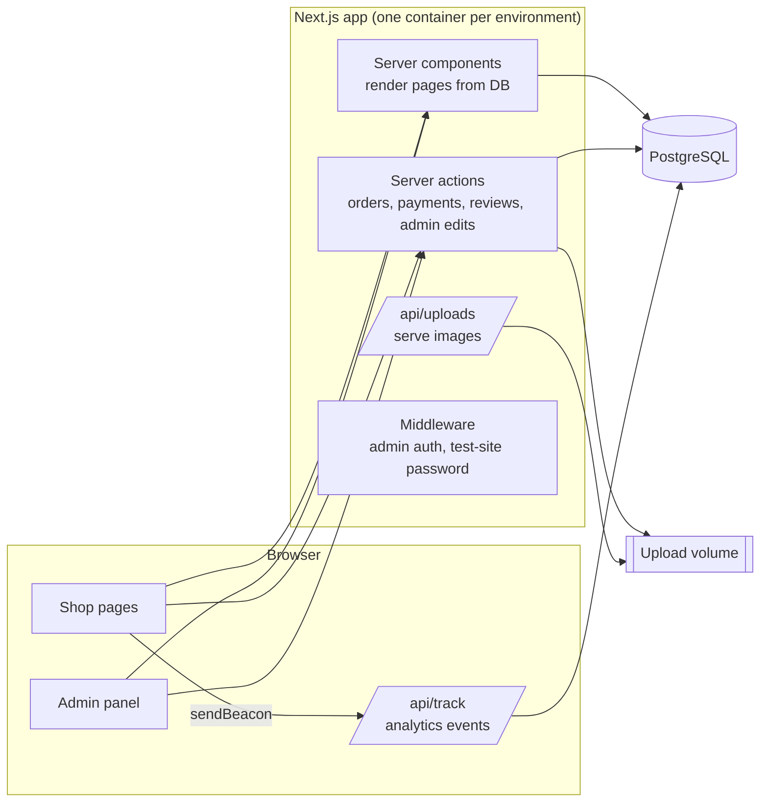
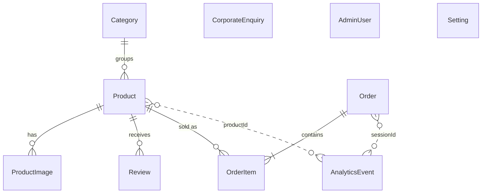

# Architecture

## Goals

1. Customers on mid-range Android phones and patchy 4G can browse and order quickly.
2. The owner runs the shop alone from a phone: add products, verify payments, see what's working.
3. New features are never seen by customers before the owner approves them.
4. Cheap to run now (one small server), with a clear path to scale.

## System overview

A single Next.js application serves the shop, the admin panel and the small API. This "modular monolith" is the right size for one business: one thing to deploy, one database, no network calls between services. The code is still split by domain (catalogue, orders, analytics, settings) in `src/lib`, so a part can be pulled out later if it ever needs to be.

### Key decisions

| Decision | Why |
|---|---|
| Server components + server actions instead of a separate REST API | Less code, no API layer to secure separately, pages arrive as HTML (fast on slow phones). |
| Every page rendered per request (`force-dynamic`) | Prices and stock change daily and the same image runs in test and production, so nothing can be baked in at build time. Pages are simple and render in milliseconds; add caching later if traffic needs it. |
| Money stored as integer **paise** | No floating-point rounding errors in totals or GST. |
| Prices recalculated on the server for every order | The browser cart is for display only; tampering with it can't change what the customer is charged. |
| UPI QR with the amount pre-filled + UTR confirmation | Matches how the owner wants to be paid (directly to their own UPI), no payment-gateway fees. The owner confirms each payment against the bank app. A gateway (Razorpay/Cashfree) can be added later behind the same order statuses. |
| Stock reserved when the order is placed, returned on cancel | Prevents selling the same last packs twice. |
| First-party analytics in Postgres | No cookie banner needed for third-party trackers, data stays with the owner, and it can be joined with real orders (revenue per traffic source, product cart rates). Microsoft Clarity can be switched on for heatmaps with one env var. |
| One Docker image promoted from test to production | What the owner approved is byte-for-byte what goes live. |

## Data model

- **Product:** `mrp`, `discountPct` and the derived `price` (retail); `corporateEnabled`, `moq`, `corporatePrice` (bulk); `stock`; `ratingAvg`/`ratingCount` are cached from approved reviews.
- **Order:** customer and address copied onto the order (history never changes when a product is edited); `customerType` RETAIL or CORPORATE; status flow `PENDING_PAYMENT → PAYMENT_SUBMITTED → CONFIRMED → PACKED → SHIPPED → DELIVERED` (or `CANCELLED`).
- **OrderItem:** name, pack size and unit price frozen at time of order.
- **AnalyticsEvent:** `type`, anonymous `visitorId` and `sessionId`, `path`, optional `productId`/`value`/`query`, first-touch `referrer`/UTM, `device`. No names, phones or IP addresses.
- **Setting:** key/value for UPI ID, QR image, delivery fee, contact details.

## Analytics design

Events tracked from the browser: `page_view`, `product_view`, `search` (with result count), `add_to_cart`, `remove_from_cart`, `begin_checkout`, `order_placed`, `enquiry_submitted`. They're sent with `navigator.sendBeacon`, so tracking never slows the page. Bots and logged-in admins are ignored.

The dashboard computes, for 7/30/90 days with change vs the previous period:

| Question for growth | Where it's answered |
|---|---|
| Are we growing? | Visitors, revenue, orders, conversion, average order; daily trends |
| Where do we lose buyers? | Funnel: visit → product → cart → checkout → order |
| Which channels to invest in? | Sources with conversion rate (Google, WhatsApp, Instagram, campaigns via `utm_source`) |
| Which products to promote, reprice or restock? | Views, cart rate, packs sold, revenue, stock |
| What do customers want that we don't sell? | Searches with zero results |
| When to post offers? | Busiest hours (India time) |
| Are customers coming back? | New vs returning visitors, repeat-customer rate |
| Is corporate growing? | Retail vs corporate revenue, enquiries won |

A rules engine (`src/lib/analytics-server.ts`) turns these into short "What to work on" suggestions.

Tip for the owner: add `?utm_source=whatsapp_broadcast` (or `instagram_bio`, `diwali_flyer`) to links you share, so each channel is measured separately.

## Security

- Admin login: bcrypt-hashed passwords, signed JWT in an `httpOnly`, `secure`, `sameSite=lax` cookie, 12-hour expiry; login rate-limited. Every admin page **and** every admin server action checks the session (middleware alone is not trusted).
- Server actions are protected against CSRF by Next.js (origin check).
- All input validated with Zod; Prisma parameterises every query (the analytics SQL uses tagged templates, never string concatenation).
- Uploads: type allow-list + magic-byte check, 5 MB limit, random file names, path-traversal guard. Payment screenshots are only served to logged-in admins.
- Order pages require the order number **and** the last 4 digits of the phone.
- Rate limits on orders, reviews, enquiries, payment submissions and order lookup.
- Security headers (`nosniff`, frame options, referrer policy); HTTPS by Caddy.
- Test environment: whole site behind a password, `noindex`, separate database, separate `AUTH_SECRET`.
- Secrets only in server env files (`chmod 600`), never in the repository or the image.

## Performance

- HTML rendered on the server; the only client JavaScript is the cart, forms, gallery and charts. No chart library: the dashboard charts are small hand-written SVG.
- Fonts self-hosted by `next/font` (no layout shift, no Google request at runtime).
- Database indexes on the hot queries (active/featured products, orders by status/date, events by type/date, by session, by product).
- Product images served with one-year immutable caching.

## Scaling path

| When | Do this |
|---|---|
| Photos slow or disk filling | Move uploads to Cloudflare R2/S3 (`src/lib/storage.ts`) and put a CDN in front |
| > ~50k events/day | Roll up `AnalyticsEvent` into daily tables nightly; keep raw events 13 months |
| Need more than one app container | Move rate limiting to Redis; run 2+ `app-prod` containers behind Caddy |
| Want automatic payment confirmation | Add Razorpay/Cashfree UPI collect; on webhook set `CONFIRMED` (status flow already fits) |
| Notifications | WhatsApp Business API / SMS on order placed and shipped |
