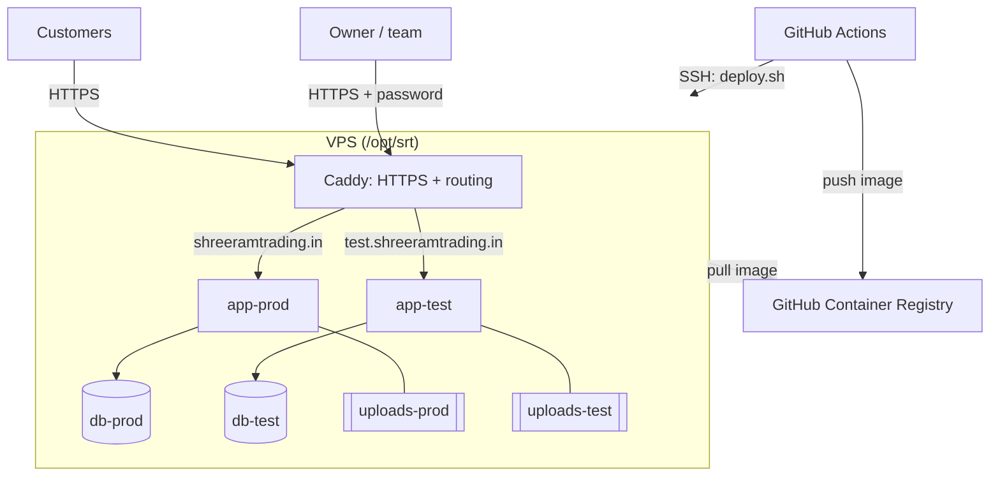

# Deployment: one server running Test and Production

Hosting was left open, so everything is plain Docker and works on any Linux VPS (Hostinger, DigitalOcean, AWS Lightsail, E2E Networks, etc.). A 2 vCPU / 4 GB RAM server in Mumbai or Bangalore runs both environments comfortably.



## 1. Domain

Point two DNS **A records** at the server's IP:

- `shreeramtrading.in` (and `www`)
- `test.shreeramtrading.in`

## 2. Server

```bash
# Ubuntu 24.04
curl -fsSL https://get.docker.com | sh
sudo adduser deploy && sudo usermod -aG docker deploy
sudo mkdir -p /opt/srt && sudo chown deploy /opt/srt
sudo ufw allow OpenSSH && sudo ufw allow 80 && sudo ufw allow 443 && sudo ufw enable
```

Copy the `deploy/` folder of this repository to `/opt/srt`, then:

```bash
cd /opt/srt
cp .env.example .env                       # image name, domains, DB passwords
cp env/prod.env.example env/prod.env       # AUTH_SECRET, owner login
cp env/test.env.example env/test.env       # different AUTH_SECRET + test site password
chmod 600 .env env/*.env
chmod +x *.sh
openssl rand -base64 48                    # use for each AUTH_SECRET / DB password
```

If the GitHub repository is private, let the server pull images:
`echo <github-token-with-read:packages> | docker login ghcr.io -u <github-user> --password-stdin`

## 3. GitHub repository settings

1. **Secrets** (Settings → Secrets and variables → Actions): `SERVER_HOST`, `SERVER_USER` (`deploy`), `SERVER_SSH_KEY` (private key whose public key is in `/home/deploy/.ssh/authorized_keys`).
2. **Variables:** `PROD_DOMAIN`, `TEST_DOMAIN`.
3. **Environments** (Settings → Environments):
   - `test`: no rules.
   - `production`: **Required reviewers → add the owner's GitHub account.** This is the approval step. Optionally restrict to the `develop` branch.
4. **Branch protection** on `develop` and `main`: require the *CI* check to pass.

## 4. First release

Push to `develop`. The pipeline builds the image and deploys test. Then on the server:

```bash
# create the logins (test and production each have their own)
docker compose exec app-test  tsx scripts/create-admin.ts
docker compose exec app-prod  tsx scripts/create-admin.ts
# optional starter catalogue (edit or delete in the admin panel afterwards)
docker compose exec app-test  tsx prisma/seed.ts
```

(`create-admin.ts` reads `ADMIN_EMAIL` / `ADMIN_PASSWORD` from the env file. Pass different values with `-e ADMIN_PASSWORD=...`.)

Approve the run in GitHub to deploy production, then in **Admin → Shop settings** on production enter the **UPI ID**, WhatsApp number and delivery charges.

## 5. Backups

```bash
crontab -e
15 2 * * * /opt/srt/backup-db.sh prod >> /opt/srt/backups/cron.log 2>&1
```

Copy `/opt/srt/backups` and the `uploads-prod` volume off the server weekly (for example with `rclone` to Google Drive or an S3 bucket). The provider's server snapshots are a good extra layer.

## Moving to managed services later

- **Database:** set `DATABASE_URL` in `env/prod.env` to a managed Postgres (Neon, Supabase, AWS RDS) and remove `db-prod`.
- **Photos:** replace the two functions in `src/lib/storage.ts` with S3 / Cloudflare R2 uploads.
- **More traffic:** run 2+ `app-prod` containers behind Caddy and move the rate limiter in `src/lib/rate-limit.ts` to Redis.
