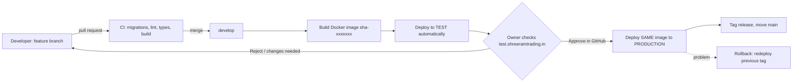

# Release process: Test → Approval → Production

Every change goes to the **test** shop first. Nothing reaches customers until the owner has looked at it on test and approved it.

## Branches

| Branch | Meaning |
|---|---|
| `feature/*` | work in progress, one per feature or fix |
| `develop` | everything that is on the **test** shop |
| `main` | exactly what is on the **live** shop; only the pipeline writes to it |

## Step by step

1. **Build the feature** on a `feature/...` branch and open a pull request into `develop`.
2. **CI checks** run automatically: a fresh database is migrated, the seed runs, then lint, type check and a production build. A pull request can't be merged while CI is red (turn on branch protection for `develop` and `main`).
3. **Merge** → the pipeline builds one Docker image tagged `sha-<commit>` and deploys it to **test**. A health check must pass or the deploy rolls back by itself.
4. **Owner review on test.** Open `https://test.shreeramtrading.in` (username/password from `env/test.env`). Use the checklist below. Test orders and payments are not real.
5. **Approve.** In GitHub → *Actions* → the running *Deploy* workflow → **Review deployments** → tick *production* → **Approve and deploy**. The owner gets an email/GitHub-app notification when approval is waiting.
6. The **same image** is deployed to production. Before that, `deploy.sh` takes a database backup. After the health check passes the commit is tagged `release-YYYYMMDD-HHMM-sha-xxxxxxx` and `main` is moved to it.

If the owner rejects (or simply doesn't approve), production is untouched. Push a fix to `develop` and a new run starts; the old run can be cancelled.

## Owner checklist on test

- [ ] Open the shop **on your phone** (most customers use phones)
- [ ] Home page rates and product photos look right
- [ ] Search for a product, open it, add to cart
- [ ] Place an order, check the QR shows the right amount
- [ ] Bulk order on `/corporate`: MOQ is enforced, bulk price shows
- [ ] Admin: the feature that changed works; analytics page loads
- [ ] Anything listed in the pull request's "How to test" section

## Database changes

- Migrations run automatically when the new version starts (`prisma migrate deploy`).
- Write migrations to be **backward compatible**: add columns as optional or with defaults; rename in two releases (add new → copy → remove old later). This keeps rollbacks safe.
- Production is backed up by `deploy.sh` before every release. Backups are in `/opt/srt/backups`.

## Rollback

- **Fast:** GitHub → Actions → *Deploy* → *Run workflow* → environment `production`, tag = the previous release's `sha-xxxxxxx`. Needs the same approval.
- **From the server:** `cd /opt/srt && ./deploy.sh prod sha-xxxxxxx`.
- **Data problem:** restore the latest backup: `gunzip -c backups/prod-<time>.sql.gz | docker compose exec -T db-prod psql -U srt -d srt`.

## Keeping test realistic

`./refresh-test-data.sh` copies production products, prices, orders and analytics into test with customer names, phones and addresses scrambled, and with the UPI ID removed so nobody can pay into the real account from test.

## Hotfixes

Same path, just faster: branch from `develop`, PR, merge, check on test, approve. There is no way to skip test, by design.
